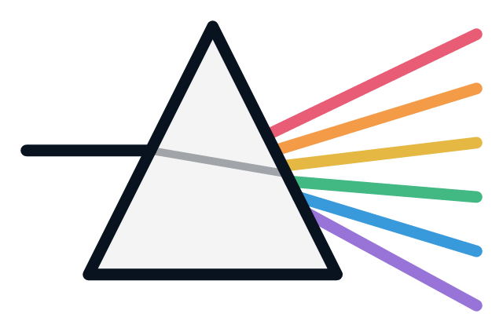
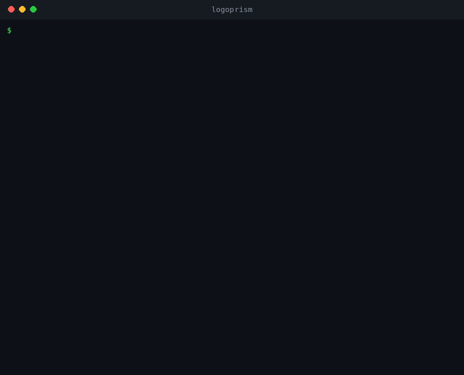

<div align="center">

<picture>
  <source media="(prefers-color-scheme: dark)" srcset="https://raw.githubusercontent.com/ramsesoriginal/logoprism/main/docs/assets/logo-dark.png">
  
</picture>

# LogoPrism

**One logo, a spectrum of possibilities.**

Turn any SVG logo into a complete, systematic set of PNG brand assets:<br>
favicon to A4, black / white / colour / greyscale / brand variants, on transparent or solid backgrounds.

[](https://pypi.org/project/logoprism/)
[](https://pypi.org/project/logoprism/)
[](https://github.com/ramsesoriginal/logoprism/actions/workflows/ci.yml)
[](https://github.com/ramsesoriginal/logoprism/blob/main/LICENSE)

</div>

```text
─⟁⫷ logoprism logo.svg      →  300 PNGs in about two seconds
```

<div align="center">



</div>

## Why

You have a logo as an SVG. You need it as a 16 px favicon, a 512 px app icon, a round avatar, a black-on-white print version, a white-on-brand-blue footer mark, an A4 PDF insert. Doing that by hand in a design tool is tedious and never quite consistent.

LogoPrism does it in one command, the same way every time, and can re-run it in CI whenever the source SVG changes.

- **Every size you need.** 16 px favicons up to A4 at 300 dpi (with the DPI written into the PNG).
- **Every treatment you need.** Black, white, original colours, greyscale, your brand colours, custom colour maps, on transparent, white, black or brand backgrounds. It works out which ones make sense for *your* logo.
- **Three shapes.** The logo's own aspect ratio, centred on a square, or scaled to sit safely inside the circle that round avatars crop to.
- **Understands real-world SVGs.** CSS classes, `currentColor`, patterns, `<use>`, and CSS `var(--brand, #f00)` colours that most renderers silently drop.
- **Fast.** One render per size and shape, every colour variant derived from it. Runs in parallel, skips what hasn't changed.
- **Friendly and scriptable.** Colourful terminal UI and an interactive wizard for people; `--json`, `--check`, exit codes and GitHub Actions annotations for pipelines.

## Install

LogoPrism needs Python 3.14 or newer. It ships as pure wheels, with no system libraries to install.

```bash
# recommended: an isolated, always-available command
uv tool install logoprism

# or run it once without installing
uvx logoprism logo.svg

# or the classics
pipx install logoprism
pip install logoprism
```

## Usage

The simplest form does something sensible. Everything below it is optional.

### 1. Convert a logo

```bash
logoprism logo.svg
```

Writes about 300 PNGs to `./logoprism-out/logo/`: favicon to A4, three shapes, black / white variants (plus original-colour and greyscale ones if the logo has colours). Not sure what you'll get? Look first:

```bash
logoprism logo.svg --dry-run      # analyse and show the plan, write nothing
logoprism inspect logo.svg        # size, content bounds, palette, colour detection
```

### 2. Choose sizes and shapes

```bash
logoprism logo.svg -s favicon,icon             # only 16 to 256 px
logoprism logo.svg -s 32,180,512,a4            # any pixel size, or A4 at 300 dpi
logoprism logo.svg -S square,circle            # skip the native aspect ratio
logoprism logo.svg -o build/brand --layout flat
```

See [Sizes](#sizes) for the presets.

### 3. Add your brand colours

```bash
logoprism logo.svg --brand-bg "#0B3D91" --brand-fg "#FFCC00"
```

Adds your foreground on transparent / white / black / brand background, and the original colours, black and white on the brand background. Low-contrast pairs are flagged (`⚠ contrast 2.1:1`) and `--min-contrast 3` drops them.

Have a light and a dark brand colour instead?

```bash
logoprism logo.svg --brand-light "#FFFFFF" --brand-dark "#0B1F3A"
```

Dark on transparent / white / the light colour, and light on transparent / black / the dark colour.

### 4. Restyle with a colour map

A dark-mode version of a dark logo, in one flag:

```bash
logoprism logo.svg --map "currentColor=#E6EDF3" --map-background transparent --map-background "#0D1117"
```

`--map SOURCE=TARGET` is repeatable. Sources are CSS colours or `currentColor`. Everything not mentioned stays as drawn, so the colourful parts of your logo survive.

### 5. Pick exactly the variants you want

Variants are named `<foreground>-on-<background>`. Select them with globs:

```bash
logoprism logo.svg -V "*-on-transparent"        # transparent backgrounds only
logoprism logo.svg -V "black-*,white-*" -x "*-on-brand-bg"
logoprism sizes                                  # list the size presets
```

### 6. Configure once, run anywhere

```bash
logoprism init          # writes a documented logoprism.toml
logoprism               # picks up logoprism.toml; `inputs` says what to convert
```

```toml
#:schema https://raw.githubusercontent.com/ramsesoriginal/logoprism/main/docs/logoprism.schema.json
inputs = ["brand/*.svg"]
output = "build/brand"
sizes  = ["favicon", "icon", "web"]
brand-bg = "#0B3D91"
brand-fg = "#FFCC00"

[themes.dark]
map = { currentColor = "#E6EDF3" }
backgrounds = ["transparent", "#0D1117"]

# per-file overrides: a table per glob
[files."brand/icon-*.svg"]
shapes = ["square", "circle"]
sizes  = ["favicon", "icon"]
```

A `logo.logoprism.toml` next to an SVG overrides settings for that file only. `logoprism config show` prints the effective settings and which layer each one came from. More in [Configuration](#configuration).

### 7. Let it guide you

```bash
logoprism --interactive          # or just run `logoprism` in a terminal with no arguments
```

<div align="center">


</div>

The wizard shows what it detected (colours, aspect ratio), asks for shapes, sizes, brand colours and variants, shows the final plan, and offers to save your answers as `logoprism.toml`.

### 8. Automate it

```yaml
# .github/workflows/brand.yml
name: Brand assets
on:
  push:
    paths: ["brand/**.svg", "logoprism.toml"]
jobs:
  brand:
    runs-on: ubuntu-latest
    steps:
      - uses: actions/checkout@v4
      - uses: astral-sh/setup-uv@v6
      - run: uvx logoprism --strict           # inputs and settings come from logoprism.toml
      - uses: actions/upload-artifact@v4
        with: { name: brand-assets, path: build/brand }
```

Check that committed assets are current (fails with exit code 1 if not):

```bash
logoprism --check
```

Machine-readable output, one JSON document on stdout:

```bash
logoprism logo.svg --json | jq '.logos[].files[] | select(.size == 512) | .path'
```

As a [pre-commit](https://pre-commit.com) hook:

```yaml
repos:
  - repo: https://github.com/ramsesoriginal/logoprism
    rev: v0.1.0
    hooks:
      - id: logoprism-check
```

Output is deterministic (no timestamps, fixed encoder settings), so regenerated files don't create noisy diffs. In GitHub Actions, warnings and errors become annotations and a summary table lands on the job page.

## What gets generated

### Variants

| Variant | When |
|---|---|
| `black-on-transparent`, `black-on-white` | always |
| `white-on-transparent`, `white-on-black` | always |
| `color-on-transparent` / `-white` / `-black` | the logo has colours |
| `grey-on-transparent` / `-white` / `-black` | the logo has colours |
| `color-`, `brand-`, `black-`, `white-on-brand-bg` | `--brand-bg` (`color-` only if the logo has colours, `brand-` only with `--brand-fg`) |
| `brand-on-transparent` / `-white` / `-black` | `--brand-fg` |
| `brand-dark-on-transparent` / `-white` / `-brand-light`<br>`brand-light-on-transparent` / `-black` / `-brand-dark` | `--brand-light` / `--brand-dark` |
| `<theme>-on-<background>` | a colour map (`--map`, or `[themes.*]` in config) |

"Has colours" means perceptibly chromatic pixels in the rendered logo (measured in OKLCH), not merely colours in the file. A navy-black ink like `#08131F` counts as black.

### Shapes

| Shape | Meaning |
|---|---|
| `native` | The logo's own aspect ratio, trimmed to the drawn content plus a small margin. Size is the longest edge. |
| `square` | Centred on a square canvas. Skipped when the logo is already square (`--force-square` overrides). |
| `circle` | Scaled to fit inside the circle inscribed in the square, so round crops (avatars, maskable icons) never cut into it. The background still fills the full square; `--round-bg` makes it round. |

`--circle-fit tight` (default) uses the smallest circle around the actual drawn pixels; `bbox` uses the circle around the bounding box. `--padding` (default 4%) sets the margin; `--no-trim` uses the SVG's viewBox instead of the drawn content.

### Sizes

| Preset | Pixels |
|---|---|
| `favicon` | 16, 32, 48 |
| `icon` | 64, 96, 128, 180, 192, 256 |
| `web` | 384, 512, 768, 1024 |
| `large` | 2048, 4096 |
| `print` | A6, A5, A4 width at 300 dpi: 1240, 1748, 2480 |
| `standard` *(default)* | 16, 32, 48, 64, 128, 256, 512, 1024, 2048, 2480 |
| `all` | every size above |

Any integer works too (`-s 72,300`), and `a3`-`a7` with an optional DPI (`a4@150`). Print sizes record their DPI in the PNG, so a print shop sees 21 cm, not "2480 px".

### Output layout

```text
logoprism-out/
└── logo/
    ├── black-on-transparent/
    │   ├── native/logo-black-on-transparent-native-16.png
    │   ├── square/…
    │   └── circle/…
    ├── white-on-black/…
    ├── …
    └── logoprism-manifest.json      # what was written, with hashes; also the incremental-build cache
```

`--layout flat` puts everything in `logoprism-out/logo/`, and `--name-pattern "{stem}_{variant}_{shape}_{size}"` changes file names. Re-running only renders what is missing or whose inputs or settings changed; `--force` redoes everything. Two logos with the same file name get `logo/` and `logo-2/`.

## Configuration

Settings come from these layers, later ones winning:

1. built-in defaults
2. global config: `logoprism config path` shows where
3. project config: `logoprism.toml`, `.logoprism.toml` or `[tool.logoprism]` in `pyproject.toml`, found by walking up from the logo
4. `[files."glob"]` tables in the project config
5. a sidecar `<logo>.logoprism.toml`
6. environment: `LOGOPRISM_<SETTING>` (e.g. `LOGOPRISM_SIZES=favicon,web`, `LOGOPRISM_BRAND_BG=#0B3D91`)
7. command-line flags

Relative paths in a config file are relative to that file. Unknown keys are errors with a "did you mean…?" hint.

| Setting (flag) | Default | |
|---|---|---|
| `inputs` | none | files, folders or globs |
| `output` (`-o`) | `logoprism-out` | |
| `layout`, `name-pattern` | `nested`, `{stem}-{variant}-{shape}-{size}` | |
| `sizes` (`-s`) | `standard` | integers, presets, `a4@dpi` |
| `shapes` (`-S`) | `native, square, circle` | |
| `variants` (`-V`), `exclude` (`-x`) | `*`, none | globs |
| `padding`, `trim`, `circle-fit`, `round-bg`, `force-square` | `0.04`, on, `tight`, off, off | |
| `brand-bg`, `brand-fg`, `brand-light`, `brand-dark` | none | any CSS colour: hex, names, `rgb()`, `hsl()`, `oklch()`, … |
| `min-contrast` | none | skip colour pairs below this WCAG ratio |
| `themes` | none | custom colour maps |
| `optimize`, `compress-level` | off, `6` | smaller PNGs or faster encoding |
| `jobs` (`-j`) | all cores | |
| `fonts`, `system-fonts` | none, on | for `<text>` in logos |

The full list, with descriptions, is in [`docs/logoprism.schema.json`](https://github.com/ramsesoriginal/logoprism/blob/main/docs/logoprism.schema.json). Editors with TOML schema support (Even Better TOML, JetBrains) complete and validate `logoprism.toml` through the `#:schema` line that `logoprism init` writes.

### Commands and exit codes

| Command | |
|---|---|
| `logoprism [FILES…]` | convert (the default) |
| `logoprism inspect FILES…` | analyse only |
| `logoprism wizard` | same as `--interactive` |
| `logoprism sizes` | list size presets |
| `logoprism init` | write a documented `logoprism.toml` |
| `logoprism config show / schema / path` | effective settings with sources / JSON Schema / global config path |
| `logoprism --install-completion` | shell completion |

| Exit code | Meaning |
|---|---|
| `0` | success (for `--check`: everything is up to date) |
| `1` | a logo failed, or `--check` found stale or missing files |
| `2` | usage or configuration error |
| `3` | warnings, with `--strict` |
| `130` | interrupted (finished files are kept; run again to resume) |

`NO_COLOR` and `FORCE_COLOR` are respected. Without a terminal there are no spinners or progress bars.

## How it works

1. **Load and normalise.** The SVG is parsed with a hardened XML parser (no entities, no network), scripts and external references are removed, and CSS `var()` colours are resolved. The renderer itself ([resvg](https://github.com/linebender/resvg)) drops those silently, which is why a logo can look fine in a browser and lose its colours when exported.
2. **Measure.** A quick render finds the drawn content and the smallest circle around it.
3. **Plan.** Variants, shapes and sizes are expanded into the exact list of files.
4. **Render once per size and shape**, in parallel. Black, white, brand and greyscale variants are derived from that raster; backgrounds are composited on top.
5. **Write atomically**, with an `sRGB` chunk (and `pHYs` for print sizes), then record everything in the manifest.

### Limitations

- Output is PNG only. Other formats are a small step from here but not part of 0.1.
- `<text>` renders with whatever fonts are available, which differs between machines. Convert text to outlines in your editor, or pass `--fonts DIR --no-system-fonts` for reproducible output. LogoPrism warns when it sees text.
- Black and white variants paint the logo's silhouette. A white shape that is meant as a cut-out inside a coloured logo becomes solid ink there.
- Python 3.14 or newer.

## Development

```bash
git clone https://github.com/ramsesoriginal/logoprism && cd logoprism
uv sync                      # creates .venv with all dev tools
uv run pytest                # tests
uv run ruff check . && uv run ruff format --check .
uv run ty check src          # types
uv run logoprism docs/assets/logoprism.svg -n
```

The demo GIFs are recorded from real runs with `uv run --group docs python scripts/record_demo.py all` (needs a POSIX terminal; WSL works). See [CONTRIBUTING.md](https://github.com/ramsesoriginal/logoprism/blob/main/CONTRIBUTING.md).

## License

[MIT](https://github.com/ramsesoriginal/logoprism/blob/main/LICENSE)
